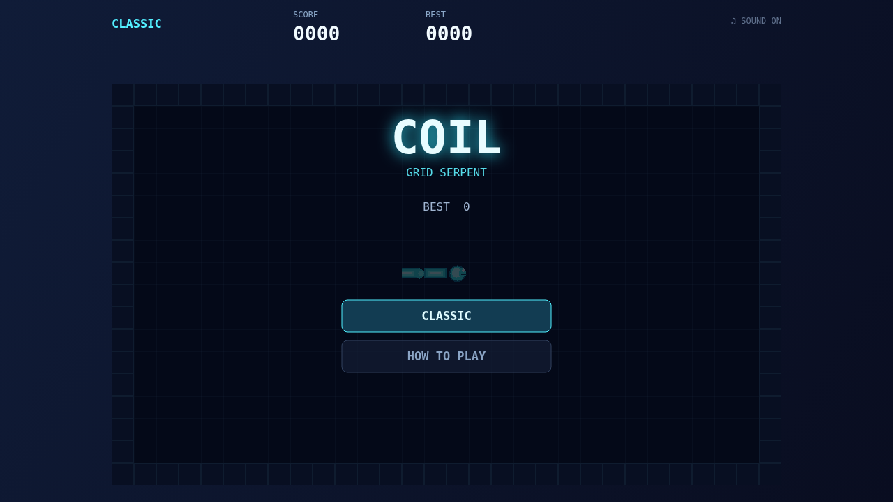

# Coil

Guide a luminous serpent through a walled grid and chase the next pellet. The board is compact, the movement is deliberate, and every turn commits on the next beat.

Each pellet adds a segment to your trail. The longer the coil grows, the more carefully you have to shape its route through the open cells.

Eat again before the combo timer empties to raise your multiplier. Keep the rhythm and each pellet is worth more; let the window close and the multiplier returns to one.

Arrow keys or WASD steer. Enter or Space chooses a menu item, P or Escape pauses, and M mutes the sound.

